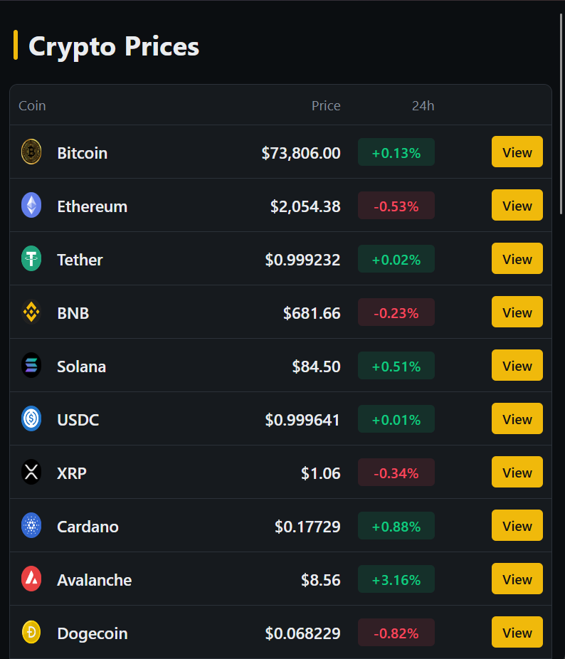

# Crypto Price Viewer

A simple cryptocurrency price viewer built with vanilla JavaScript, HTML and CSS. It shows live USD prices and the 24h change for 34 of the top coins, with data from the [CoinGecko API](https://www.coingecko.com/en/api).



## Run it

No build step and no dependencies. Open `index.html` in your browser.

## Project structure

```
├── index.html          # Page structure
├── css/
│   └── style.css       # Styles
├── js/
│   └── app.js          # Fetches prices and renders the table
└── assets/
    └── img/            # Local coin icons
```

## Notes

- Prices come from CoinGecko's public `coins/markets` endpoint in a single request. Free usage is rate limited, so reload sparingly.
- The coin list lives in `arrayCoins` in `js/app.js`. Each entry uses a CoinGecko id and a local icon from `assets/img/`. To add a coin, add an entry with its CoinGecko id (see the coin page URL, e.g. `coingecko.com/en/coins/bitcoin` → `bitcoin`) and an icon.
